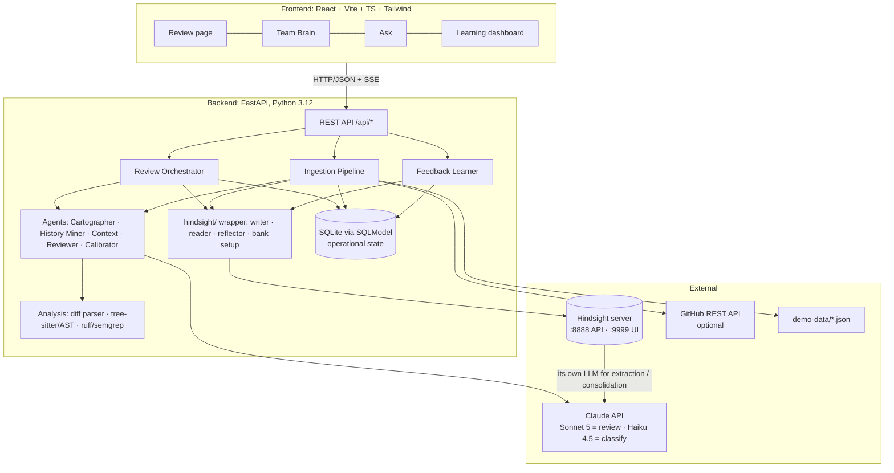
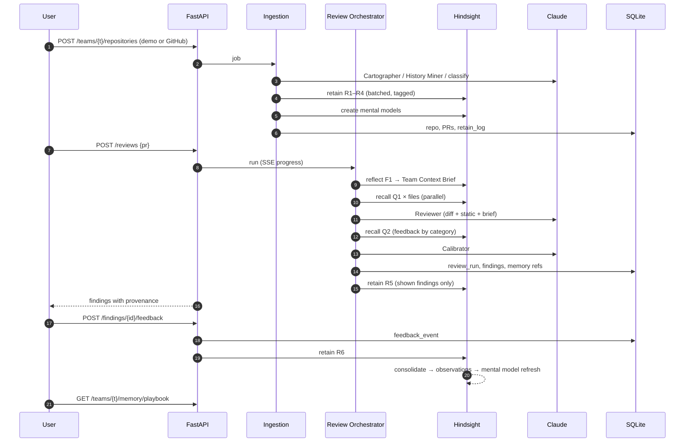

# ReviewMind — Architecture

> **ReviewMind is an AI code reviewer that learns how *your* team reviews code.** It remembers team
> conventions, architectural decisions, past review feedback, and which of its own suggestions were
> accepted or rejected.
>
> Memory design (§4 and §16) is specified in depth in [memory-design.md](memory-design.md).
> This document covers everything else and summarises the memory design where it is needed.

---

## 1. Product architecture

### 1.1 Problem
Generic AI reviewers are noisy. They flag the same things for every team, ignore local decisions
("we use `httpx`, not `requests`"), and never learn from being told "we don't care about that here".
Teams end up muting them. Meanwhile real team knowledge is spread across CONTRIBUTING files, ADRs
and hundreds of old review threads that new engineers never read.

### 1.2 Product promise
1. **Reviews like your team.** It applies conventions your team actually enforces, and cites the PR or ADR where each one came from.
2. **Stays quiet where your team doesn't care.** Rejected suggestion types are suppressed, and the suppression is visible.
3. **Gets better every PR.** Every accept, reject or edit becomes memory. A learning curve proves it.

### 1.3 Users and surfaces

| User | Surface | Key job |
|---|---|---|
| PR author | **Review page** | Read findings, then accept / reject / edit with a one-line reason |
| Reviewer / tech lead | **Team Brain** | See learned conventions, promote to rule, retire stale rules, "Teach ReviewMind" |
| New engineer | **Ask the Team Brain** | "How do we handle money here?" answered with evidence from past PRs |
| Judges / eng manager | **Learning dashboard** | Acceptance-rate curve, noise suppressed, generic vs. memory side by side |

### 1.4 Signature UX moments (for the demo)
- **Side-by-side toggle, "Without memory ↔ With ReviewMind memory"** on the same PR. Generic review: 14 comments. ReviewMind: 5 comments, each with a "Because of PR #42 (@alice, Mar 14)" chip.
- **Provenance badges** on every finding: `Generic` · `Repo` · `Team rule` · `Past review` · `Learned from feedback`.
- **Live learning:** reject a suggestion with a reason. The Team Brain shows "learning…", then a new line appears in the Noise Profile. Re-run the review and that finding is gone, with "Suppressed (1)" shown.

---

## 2. System architecture



**Key decisions**

| Decision | Choice | Why |
|---|---|---|
| Long-term memory | **Hindsight** (Docker, `ghcr.io/vectorize-io/hindsight`) | Core of the product. Retain/recall/reflect, observations, mental models, directives |
| Operational DB | SQLite + SQLModel (Postgres-ready) | Review runs, findings and feedback are *app state*, not memory. Zero ops for a hackathon |
| LLM | Claude Sonnet 5 (reviewer, context), Haiku 4.5 (thread classification, change summaries) | Quality where it matters, cheap for bulk ingestion. Hindsight is configured with `HINDSIGHT_API_LLM_PROVIDER=anthropic` |
| Code analysis | unified-diff parser + tree-sitter (symbols) + ruff/semgrep (generic findings) | Deterministic generic layer; LLM tokens go to team-specific reasoning |
| Source of PRs | `demo-data/` JSON (primary) + GitHub public PR fetch (secondary) | The demo must not depend on network or rate limits |
| Streaming | Server-Sent Events for review progress | Shows the agent "thinking with memory" step by step |
| Orchestration | Plain async Python pipeline, no agent framework | Deterministic, debuggable, fast to build |

---

## 3. Agent architecture

A **fixed pipeline of specialised agents**. Each agent is a function: typed input → Claude call
(structured output) → typed output. There is no autonomous agent loop, which keeps latency and
behaviour predictable in a demo.

| Agent | Phase | Input | Hindsight ops | Output |
|---|---|---|---|---|
| **Cartographer** | Ingestion | repo tree, manifests, READMEs, key module headers | retain R2 (repo facts); create "Architecture Map" mental model | repo profile (languages, layers, areas) |
| **History Miner** | Ingestion | historical PRs + review threads | retain R3/R4 | per-thread classification: category, area, resolution (`applied / rejected / discussed`), is_convention_signal |
| **Doc Ingestor** | Ingestion | CONTRIBUTING, ADRs, style guides | retain R1 | — |
| **Context Agent** | Review | PR metadata + change summaries | **reflect F1** (Team Context Brief) + **recall Q1** per file | `TeamContextBrief` + per-file memory snippets with ids |
| **Reviewer** | Review | diff hunks, symbols, static-analysis output, brief, snippets | none (pure reasoning) | candidate findings, each with `category`, `layer`, `evidence_ids`, `suggested_fix` |
| **Calibrator** | Review | candidate findings + brief.suppress + recall Q2 | recall Q2 | final findings: keep / down-rank / suppress, `team_confidence`, reason |
| **Learner** | Feedback | feedback event | retain R5 (after review), R6/R7; refresh mental models | updated learning stats |

**Reviewer rules (prompt contract)**
- Every finding declares its **layer**: `generic | repo | team | history | feedback`. A non-generic finding **must** cite ≥1 `evidence_id` returned by Hindsight. Uncited "team" claims are dropped by a validator. This is the anti-hallucination guarantee.
- Maximum N findings per file, ordered by severity × team_confidence.
- Fixes use the team's preferred form when memory has an "edited" example.

---

## 4. Hindsight memory architecture (summary)

Full spec: [memory-design.md](memory-design.md).

- **One bank per team** (`team-<slug>`). Repos are scoped with `repo:<slug>` tags; team-wide memories are untagged so `tags_match="any"` includes them.
- **World** = repo facts, docs/ADRs, human review threads. **Experience** = ReviewMind's own findings and developers' reactions to them. **Observations** = consolidated beliefs with evidence. **Mental models** = Team Review Playbook, Noise Profile, Architecture Map, Reviewer Scorecard. **Directives** = human-promoted hard rules.
- Bank `retain_mission` / `observations_mission` / `reflect_mission` + disposition (skepticism 4) make Hindsight extract *conventions and outcomes*, not trivia.
- **Code is never stored in Hindsight.**

---

## 5. Data flow (end-to-end)



---

## 6. Repository ingestion flow

1. **Register** the repo (`demo` source reads `demo-data/repositories/<slug>/`; `github` source uses the REST API, public repos, last N merged PRs).
2. **Snapshot**: clone or load the file tree into a temp dir, build a symbol index (tree-sitter). Local only; never sent to Hindsight.
3. **Cartographer**: detects languages, frameworks, layers and areas, and writes 5–15 **repo facts** → retain R2.
4. **Doc Ingestor**: splits CONTRIBUTING/ADRs/style docs by heading → retain R1 (`document_id` per section).
5. **History Miner** (Haiku, batched): for each merged PR, group comments into threads, then classify each thread:
   `{category, area, resolution: applied|rejected|discussed|noise, is_convention_signal, one_line_rule?}`.
   Drop `noise` (e.g. "LGTM", bot comments). Narrate each remaining thread → retain R3; one R4 summary per PR.
   Timestamps are the real comment times, so Hindsight's temporal reasoning sees convention drift.
6. **Bootstrap mental models**: create Playbook, Noise Profile, Architecture Map. Wait for the operation, then cache the rendered text for the UI.
7. **Report**: "Ingested 32 PRs, 118 review threads → 41 retained; 9 conventions detected." Stream progress over SSE.

Idempotent: deterministic `document_id`s + `retain_log` unique key `(bank_id, document_id, content_hash)`.

---

## 7. Code review flow

1. **Load PR**: diff, title, description, author, `created_at`, head SHA.
2. **Analyse** (deterministic): parse hunks → map to areas/languages → extract touched symbols → run ruff/semgrep on changed files → Haiku writes a one-line *change summary* per file ("adds float arithmetic to refund amount calc").
3. **Context Agent**:
   - `reflect` F1 → `TeamContextBrief` (cached by `repo + head_sha + bank_version`).
   - `recall` Q1 per file in parallel (`asyncio.gather`), `query_timestamp = PR.created_at`.
4. **Reviewer** (Sonnet): per-file prompt = hunks + symbols + static findings + brief + file snippets → candidate findings with layer and evidence ids. Validator enforces the citation rule.
5. **Calibrator**: for each category present, run recall Q2; merge with `brief.suppress`. For each finding, decide `keep | downrank | suppress`, set `team_confidence ∈ [0,1]` and a human-readable reason ("Rejected 4× in `tests/` — 'we don't type fixtures'").
6. **Persist + retain**: store findings; retain R5 for *shown* findings only.
7. **Respond**: findings grouped by file; suppressed ones in a collapsible section; a "without memory" run is available through `use_memory=false` (skips steps 3 and 5 and uses the same Reviewer). That is the side-by-side view.

Latency target: < 25 s for a 5-file PR (one reflect, parallel recalls, one Sonnet call per file in parallel).

---

## 8. Feedback learning flow

| Signal | Captured from | Retain | Effect |
|---|---|---|---|
| Accept | 👍 button | R6 `outcome:accepted` | boosts category/scope in the Noise Profile / Scorecard |
| Reject + reason | 👎 + required 1-line reason (suggested chips: "not our convention", "wrong", "too nitpicky", "out of scope") | R6 `outcome:rejected` | enough consistent rejections → `suppress` entry |
| Edit | "Accept with changes" text box | R6 `outcome:edited` with before → after | teaches the preferred fix form |
| Applied (implicit) | the suggested line changed in a later commit | R7 `outcome:applied` | weak positive |
| Ignored (implicit) | merged with the line unchanged and no reaction | R7 `outcome:ignored` | weak negative |
| Teach | "Teach ReviewMind" box | R8 | new world fact → may become a convention |
| Promote | "Make this a team rule" on an observation | `create_directive` | hard rule in reflect |

After each feedback event: Hindsight auto-consolidates → observations → mental models with
`refresh_after_consolidation`. The backend invalidates the cached brief for that repo
(`bank_version++`), so the next review reflects the new knowledge. The UI polls
`GET /teams/{t}/memory/timeline` to show "ReviewMind learned: …".

---

## 9. Evaluation strategy

**Question to prove:** *does memory make reviews more team-specific, and does that keep improving with feedback?*

### 9.1 Dataset (`evaluation/benchmark.json`, built from `demo-data/`)
- Synthetic but realistic team **"Acme Payments"**: 2 repos (`payments-service` Python/FastAPI, `checkout-web` TS/React).
- **~40 historical PRs** encoding **10 planted conventions** (e.g. Decimal for money, thin handlers, httpx not requests, idempotency keys, no `print`, test naming), **2 conventions that change over time**, and **5 "noise" categories the team rejects** (docstrings on private helpers, type hints in tests, import sorting nits, etc.).
- **12 held-out PRs** (chronologically after the history) with ground-truth human review comments + labels `{should_flag[], should_not_flag[]}`.
- Chronological split: memory contains only events before each test PR (`query_timestamp` enforced).

### 9.2 Configurations

| ID | Config | What it isolates |
|---|---|---|
| A | Generic: Reviewer only, no memory | baseline |
| B | Naive RAG: docs + threads embedded in a vector store, top-k into the prompt | "memory as vector DB" |
| C | ReviewMind cold: Hindsight after ingestion, no feedback | value of structured memory |
| D | ReviewMind + simulated feedback over k = 0, 5, 10, 20 events | **learning curve (headline)** |

Feedback is simulated by a scripted "developer" who accepts or rejects from the ground-truth labels (with 10% label noise to test robustness).

### 9.3 Metrics
- **Convention precision / recall**: findings matched to `should_flag` (same file, ±5 lines, LLM judge agrees on intent).
- **Noise rate**: % of findings that fall in `should_not_flag` categories. *Key metric.*
- **Simulated acceptance rate**: share of findings the scripted developer would accept.
- **Citation validity**: % of non-generic findings whose evidence ids resolve to a real, relevant memory.
- **Drift correctness**: on PRs touching changed conventions, % that apply the *new* rule.
- Latency and cost per review.

`evaluation/evaluate.py` runs every config in its own **sandbox bank** and writes `evaluation/results/<timestamp>.json` plus a chart that the Learning dashboard renders.

Target story: A → noise ~40%; B → better recall, still noisy, fails drift; C → higher precision, correct drift; D → noise falls steadily with k.

---

## 10. MVP scope (must ship)

1. Docker compose: Hindsight + backend + frontend, one command.
2. Demo data: Acme Payments, `payments-service` repo only (Python), ~30 PRs, 12 held-out.
3. Ingestion from demo data: Doc Ingestor, History Miner, Cartographer (lite), bank config, 2 mental models (Playbook, Noise Profile).
4. Review flow end-to-end, with provenance badges, citations and the suppressed section.
5. Accept / reject(+reason) / edit feedback → retain → visible learning.
6. Pages: Review (with memory on/off toggle), Team Brain (mental models + recent observations + promote-to-directive), Learning timeline.
7. Evaluation: configs A, C, D with noise rate + acceptance curve. One chart.
8. README with a 3-minute demo script.

**Explicitly out of MVP:** GitHub App/webhooks, auth, multi-team UI, TS repo, config B.

## 11. Stretch goals (in priority order)

1. Config B (naive RAG) in eval: proves "not a vector DB" with numbers.
2. GitHub integration: fetch a public PR by URL; post the review as PR comments; read 👍/👎 reactions as feedback.
3. "Ask the Team Brain" chat (reflect + citations) for onboarding.
4. Second repo (TS) showing team-wide conventions carry across repos while repo facts stay scoped.
5. Convention drift view: timeline of a rule changing, with evidence.
6. Per-developer context (e.g. "juniors get more explanatory comments"), using the `author:` tag. Handle with care.
7. Slack digest: "This week ReviewMind learned 3 new things about your team."

---

## 12. Risks and mitigations

| Risk | Impact | Mitigation |
|---|---|---|
| Reflect latency (seconds) | slow demo | one reflect per review; cache by head SHA; parallel recalls; stream progress over SSE; pre-warm the demo PR |
| Consolidation is async, so learning isn't visible instantly | weak live demo | "learning…" state; explicit `refresh_mental_model` in the demo; show the `retain_log` timeline immediately |
| Hindsight API differs from docs / version drift | integration stalls | all calls behind `app/hindsight/`; pin image tag; **hour-1 spike** validating retain tags, `document_id` upsert, experience classification, mental model create/refresh, reflect `response_schema` |
| Memory learns wrong rules (one loud reviewer, noisy labels) | bad suggestions | skepticism 4, evidence counts, ≥2-event threshold for suppression, human-only directives, UI to retire rules |
| Hallucinated "team rules" | loss of trust | mandatory `evidence_ids` validated against recall/reflect results; drop uncited team findings |
| LLM cost during ingestion | budget | Haiku for classification; batch threads; cap PR count; cache results in SQLite |
| Synthetic data looks fake to judges | credibility | realistic PR texts with real disagreements; optional GitHub PR import from a real OSS repo in the demo |
| Eval judged by LLM is biased | weak evidence | line-proximity match first; LLM judge only for intent; publish per-PR results |
| Secrets/PII in memory | real-world blocker | Memory Defense ON; never retain code; strip code blocks |
| Scope creep | nothing finished | MVP list above is the contract; stretch goals only after the demo path works end-to-end |

---

## 13. Project directory structure

```
reviewmind/
├── backend/
│   ├── app/
│   │   ├── main.py                    # FastAPI app, routers, lifespan (bank bootstrap)
│   │   ├── config.py                  # pydantic-settings: keys, URLs, model ids
│   │   ├── api/
│   │   │   ├── teams.py  repositories.py  reviews.py  findings.py  memory.py  eval.py
│   │   │   └── sse.py                 # progress streaming helpers
│   │   ├── agents/
│   │   │   ├── base.py                # structured-output Claude call helper
│   │   │   ├── cartographer.py  history_miner.py  doc_ingestor.py
│   │   │   ├── context_agent.py  reviewer.py  calibrator.py  learner.py
│   │   │   └── prompts/               # prompt templates (.md)
│   │   ├── analysis/
│   │   │   ├── diff_parser.py  symbols.py  static_checks.py  change_summary.py
│   │   ├── hindsight/
│   │   │   ├── client.py              # thin wrapper over the Hindsight client, retries
│   │   │   ├── bank_setup.py          # missions, disposition, mental models
│   │   │   ├── tags.py                # controlled tag vocabulary
│   │   │   ├── writer.py              # R1–R8 narrators + retain_log
│   │   │   ├── reader.py              # Q1–Q4 recall builders
│   │   │   └── reflector.py           # F1 brief, mental model reads, directives
│   │   ├── memory/
│   │   │   ├── learning.py            # feedback → retain → cache invalidation
│   │   │   └── brief_cache.py
│   │   ├── models/                    # SQLModel tables + Pydantic DTOs
│   │   │   ├── db.py  tables.py  schemas.py
│   │   └── services/
│   │       ├── ingestion_service.py  review_service.py  feedback_service.py
│   │       ├── sources/ demo_source.py  github_source.py
│   ├── tests/
│   │   ├── test_diff_parser.py  test_tags.py  test_writer_narration.py
│   │   ├── test_review_flow.py        # with a fake Hindsight
│   │   └── fakes/fake_hindsight.py
│   ├── requirements.txt
│   └── .env.example
├── frontend/
│   ├── src/
│   │   ├── pages/ ReviewPage.tsx  TeamBrainPage.tsx  LearningPage.tsx  AskPage.tsx  ReposPage.tsx
│   │   ├── components/ FindingCard.tsx  ProvenanceBadge.tsx  EvidenceChip.tsx  FeedbackBar.tsx
│   │   │               DiffView.tsx  MemoryToggle.tsx  LearningCurve.tsx  ConventionRow.tsx
│   │   ├── hooks/ useReview.ts  useSSE.ts  useTeamBrain.ts
│   │   ├── services/ api.ts
│   │   └── types/ api.ts
│   └── package.json
├── demo-data/
│   ├── repositories/payments-service/ (files, CONTRIBUTING.md, docs/adr/*)
│   ├── pull-requests/payments-service/*.json   # historical + held-out PRs with diffs
│   └── reviews/payments-service/*.json         # review threads per PR
├── evaluation/
│   ├── benchmark.json  evaluate.py  simulate_feedback.py  judge.py
│   └── results/
├── docs/ architecture.md  memory-design.md  demo-script.md
├── docker-compose.yml   # hindsight, backend, frontend
├── README.md
└── CLAUDE.md
```

---

## 14. API contracts

Base: `/api`. JSON. Errors: `{ "error": { "code": str, "message": str } }`. Long jobs return `202` + a job id and stream `GET /api/jobs/{id}/events` (SSE).

### Teams & repositories
```http
POST /api/teams
{ "name": "Acme Payments", "slug": "acme-payments" }
→ 201 { "id": "tm_1", "slug": "acme-payments", "bank_id": "team-acme-payments" }

POST /api/teams/{team_id}/repositories
{ "source": "demo" | "github", "slug": "payments-service", "url": "https://github.com/o/r", "max_prs": 50 }
→ 202 { "repository_id": "rp_1", "job_id": "job_9" }

GET /api/jobs/{job_id}        → { "status": "running|done|failed", "progress": 0.6, "stats": {...} }
GET /api/jobs/{job_id}/events → SSE: { "step": "history_miner", "message": "Thread 41/118 classified" }

GET /api/teams/{team_id}/repositories/{repo_id}/pull-requests?held_out=true
→ [{ "id": "pr_57", "number": 57, "title": "...", "author": "bob", "created_at": "...", "files_changed": 4 }]
```

### Reviews
```http
POST /api/reviews
{ "repository_id": "rp_1", "pull_request_id": "pr_57", "use_memory": true }
  # or instead of pull_request_id: "diff": "<unified diff>", "title": "...", "created_at": "..."
→ 202 { "review_id": "rv_3", "job_id": "job_10" }

GET /api/reviews/{review_id}
→ {
  "id": "rv_3", "status": "done", "use_memory": true, "latency_ms": 18400,
  "brief": { "applicable_conventions": [...], "suppress": [...], "watch_for": [...] },
  "findings": [{
    "id": "fd_12", "file": "app/api/refunds.py", "line_start": 88, "line_end": 90,
    "severity": "high|medium|low|nit", "category": "correctness",
    "layer": "generic|repo|team|history|feedback",
    "title": "Use Decimal for currency amounts",
    "body": "...", "suggested_fix": "...",
    "team_confidence": 0.91, "status": "shown|suppressed|downranked",
    "calibration_reason": "Enforced in 6 past PRs; never rejected",
    "evidence": [{ "memory_id": "...", "kind": "observation|world|experience|mental_model|directive",
                   "text": "...", "source_ref": { "type": "pr_thread", "pr": 42, "url": "..." } }],
    "feedback": null
  }],
  "counts": { "shown": 5, "suppressed": 3 }
}

GET /api/reviews/compare?pull_request_id=pr_57   # latest memory-on vs memory-off runs
→ { "without_memory": ReviewSummary, "with_memory": ReviewSummary }
```

### Feedback
```http
POST /api/findings/{finding_id}/feedback
{ "action": "accepted|rejected|edited", "reason": "we don't document private helpers",
  "edited_fix": "...", "developer": "carol" }
→ 200 { "feedback_id": "fb_4", "retained": true, "learning_status": "consolidating" }
```

### Memory (Team Brain)
```http
GET  /api/teams/{team_id}/memory/playbook       → { "mental_models": [{ "id","name","content","updated_at" }] }
GET  /api/teams/{team_id}/memory/observations?repo=&limit=
     → [{ "id","text","tags","evidence_count","source_fact_ids","updated_at" }]
GET  /api/teams/{team_id}/memory/timeline?since=  → [{ "at","event":"R6","summary":"Learned: ...","document_id" }]
POST /api/teams/{team_id}/memory/ask       { "question": "How do we handle money?" } → { "answer_md","based_on":[...] }
POST /api/teams/{team_id}/memory/teach     { "statement": "...", "repo_id": null, "author": "alice" } → 202
POST /api/teams/{team_id}/directives       { "from_observation_id": "...", "name": "...", "content": "...", "tags": [] } → 201
PATCH /api/teams/{team_id}/directives/{id} { "is_active": false }
POST /api/teams/{team_id}/memory/refresh   → 202  # force mental model refresh (demo)
```

### Stats & evaluation
```http
GET  /api/teams/{team_id}/stats → { "reviews": 14, "acceptance_rate_series": [{ "n_feedback": 0, "rate": 0.52 }, ...],
                                    "suppressed_total": 23, "by_category": {...} }
POST /api/eval/runs { "configs": ["A","C","D"], "feedback_steps": [0,5,10,20] } → 202 { "eval_run_id": "ev_1" }
GET  /api/eval/runs/{id} → { "status", "results": { "A": {...metrics}, "D": [{ "k": 5, ... }] } }
```

---

## 15. Database schema (SQLite / SQLModel)

Operational state only. **Knowledge lives in Hindsight.** The app DB stores ids that point into it.

```sql
teams            (id PK, slug UNIQUE, name, bank_id UNIQUE, bank_version INT DEFAULT 0, created_at)
repositories     (id PK, team_id FK, slug, source, url, default_branch, languages JSON,
                  ingested_at, UNIQUE(team_id, slug))
pull_requests    (id PK, repository_id FK, number, title, body, author, created_at, merged_at,
                  head_sha, diff TEXT, is_held_out BOOL, UNIQUE(repository_id, number))
review_threads   (id PK, pull_request_id FK, file, line, category, area, resolution,
                  is_convention_signal BOOL, narrative TEXT, retained_document_id)
jobs             (id PK, kind, status, progress REAL, stats JSON, error, created_at, finished_at)

review_runs      (id PK, pull_request_id FK NULL, repository_id FK, use_memory BOOL, status,
                  brief JSON, bank_version INT, latency_ms, cost_usd, created_at)
findings         (id PK, review_run_id FK, file, line_start, line_end, severity, category, layer,
                  title, body, suggested_fix, team_confidence REAL,
                  status  -- shown|suppressed|downranked
                  , calibration_reason, retained_document_id)
finding_memory_refs (finding_id FK, memory_id, memory_kind, document_id, snippet, rank,
                  PRIMARY KEY(finding_id, memory_id))
feedback_events  (id PK, finding_id FK, action, reason, edited_fix, developer, implicit BOOL,
                  created_at, retained_document_id)

retain_log       (id PK, team_id FK, event_type  -- R1..R8
                  , document_id, content_hash, tags JSON, summary, status, operation_id,
                  created_at, UNIQUE(team_id, document_id, content_hash))
directives       (id PK, team_id FK, hindsight_directive_id, name, content, tags JSON,
                  from_observation_id, is_active, created_by, created_at)
brief_cache      (repository_id FK, head_sha, bank_version, brief JSON, created_at,
                  PRIMARY KEY(repository_id, head_sha, bank_version))

eval_runs        (id PK, configs JSON, status, results JSON, created_at)
```

Indexes: `findings(review_run_id)`, `feedback_events(finding_id)`, `retain_log(team_id, created_at)`, `pull_requests(repository_id, created_at)`.

---

## 16. Hindsight memory strategy (summary)

Full spec with exact retain templates, recall queries, reflect schemas and mental models:
[memory-design.md](memory-design.md).

| Operation | What | When |
|---|---|---|
| **Retain** | Narrated events: team docs (R1), repo facts (R2), historical review threads *with resolution* (R3/R4), ReviewMind's own shown findings (R5), explicit and implicit developer feedback (R6/R7), human "teach" statements (R8). Tagged `repo/area/lang/cat/source/outcome`, deterministic `document_id`, real timestamps. **Never code.** | Ingestion, after each review, on each feedback event |
| **Recall** | Per-file conventions & past lessons (Q1, observations first, time-anchored); feedback history per category (Q2); related past discussions for evidence chips (Q3); ad-hoc questions (Q4) | During review (parallel), UI |
| **Reflect** | Team Context Brief per PR (F1, structured); mental models Team Review Playbook / Noise Profile / Architecture Map / Reviewer Scorecard (F2, auto-refresh after consolidation); directives from human promotion (F3) | Start of each review; after consolidation; on promotion |

The differentiator in one line: **retain outcomes, not just content. Let Hindsight consolidate them
into beliefs, and reflect on those beliefs before every review.**
