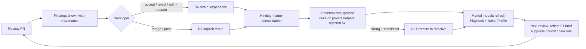

# ReviewMind — Hindsight Memory Design

> Covers §4 (Hindsight memory architecture) and §16 (Hindsight memory strategy) of the architecture.
> API names below were checked against the Hindsight docs (hindsight.vectorize.io) on 2026-09-29.
> Items marked **[spike]** must be confirmed in the first hour of implementation.

---

## 0. The one-paragraph version

ReviewMind does **not** put code into Hindsight. Code is context, not memory. Hindsight stores
**what the team believes and how it behaves**: conventions and the reasons behind them,
architectural decisions, what reviewers asked for in past PRs and whether authors agreed, what
ReviewMind itself suggested, and how developers reacted to it. Hindsight turns those events into
**observations** (beliefs backed by evidence), which feed **mental models** (a living "Team Review
Playbook" and a "Noise Profile"). Humans can promote a belief to a **directive** (a hard rule).
Every review starts with a `reflect` over this memory, so each PR is reviewed the way *this team*
reviews code, and gets closer to that each time someone accepts or rejects a suggestion.

---

## 1. Five kinds of knowledge, and where each one lives

This is the core distinction of the product. Each finding in the UI carries a badge for the layer it
came from.

| # | Layer | Example | Source | Where it lives | Changes over time? |
|---|---|---|---|---|---|
| 1 | **Generic code review** | "Possible `None` dereference", "SQL built by string concatenation" | LLM prior knowledge + static analysers (ruff, semgrep) | **Not in Hindsight.** Model weights + tool output | No |
| 2 | **Repository knowledge** | "`payments-service` uses the repository pattern; handlers in `app/api` never touch SQLAlchemy sessions directly" | Repo scan: tree, manifests, READMEs, ADRs, summaries of key modules | Hindsight **world** facts tagged `repo:<slug>` (summaries, never raw code). Raw code sits in a local, throwaway code index | Slowly, as the code changes |
| 3 | **Team memory** | "The team uses `httpx` instead of `requests` (decided March 2026, ADR-007)"; "Money is always `Decimal`, never `float`" | CONTRIBUTING, ADRs, style docs, *patterns across* historical review comments | Hindsight **world** facts, then consolidated **observations**, then the **"Team Review Playbook"** mental model. Directives if a human promotes them | Yes. Conventions get added and replaced (temporal) |
| 4 | **Historical review experience** | "In PR #42 @alice asked to move validation into the service layer; the author agreed and changed it" / "I (ReviewMind) flagged a missing idempotency key in PR #57" | Mined PR review threads + ReviewMind's own past reviews | Hindsight **experience** (own actions) + **world** (human reviewer events), tagged `source:pr_history` / `source:agent_review` | Grows with every PR |
| 5 | **Developer feedback** | "@bob rejected ReviewMind's suggestion to add docstrings to test fixtures: 'we don't document tests'" | Accept / reject / edit clicks in the UI, plus implicit signal (a suggestion that was applied before merge) | Hindsight **experience** tagged `source:feedback outcome:<x> category:<y>`, consolidated into the **"Noise Profile"** mental model | Grows with every review. This is what drives learning |

Rules that follow from this table:

- Layer 1 is never retained. It is the baseline we measure against.
- Layers 2–5 are all in **one bank per team**. Repositories are scoped with tags, not with separate banks, because team conventions apply across repos.
- The "team-specific over time" differentiator comes from layers 4 and 5 feeding observations. That is Hindsight doing consolidation, and a vector store cannot do it.

---

## 2. Why this is not "Hindsight as a vector DB"

| Vector-DB usage (what we avoid) | How ReviewMind uses Hindsight |
|---|---|
| Embed code chunks and do nearest-neighbour lookups | Retain **narrated events** ("who asked what, about which module, why, what happened"). Hindsight extracts facts, entities (developers, modules, libraries, ADRs) and time |
| Every chunk is equally true forever | **Temporal** facts: "we moved to httpx in March" beats the older "use requests". Recall is anchored with `query_timestamp` = PR creation time |
| No concept of belief strength | **Observations** consolidate many events into evidence-backed beliefs ("rejects docstring suggestions on private helpers — 5 rejections, 0 accepts"). `include.source_facts` gives us the evidence for the UI |
| Retrieval returns fragments; the app has to synthesise them | **Reflect** with `response_schema` returns a structured Team Context Brief that already prioritises and reconciles conflicts |
| No agent identity | Bank **missions + disposition** make the reviewer sceptical of one-off comments and literal about stated rules |
| No hard rules | **Directives**: humans promote an observation to an enforced rule |
| No summarised long-term understanding | **Mental models** ("Team Review Playbook", "Noise Profile", "Architecture Map") auto-refresh after consolidation and are shown in the UI as the team brain |
| No record of the agent's own actions | **Experience** memories record what ReviewMind itself said, so it can learn from its own track record |

---

## 3. Bank topology

```
bank: team-<team_slug>             one per team (demo: team-acme-payments)
  ├─ world facts        repo facts, conventions, ADRs, human review events
  ├─ experience facts   ReviewMind's own reviews + developer reactions to them
  ├─ observations       consolidated, evidence-backed beliefs (auto)
  ├─ mental models      Team Review Playbook · Noise Profile · Architecture Map (per repo)
  └─ directives         human-promoted hard rules
```

A second bank, `team-<slug>-sandbox`, is created for the evaluation harness, so benchmark runs never
pollute the real team memory. It is also reset between eval configurations.

### 3.1 Bank configuration (`update_bank_config`)

```text
retain_mission:
  You are the memory of a software team's code review practice. Extract:
  conventions and rules the team enforces, the rationale behind them, architectural
  decisions (and when they changed), which modules/paths/languages they apply to, who
  stated or enforced them, review suggestions and whether they were accepted, rejected or
  modified and why. Record the date. Ignore raw source code, secrets, greetings, CI noise
  and bot chatter. A single reviewer's opinion is NOT a team rule unless stated as one.

observations_mission:
  Consolidate into durable team review norms. For each norm state: the rule, its scope
  (repo/module/path/language), its strength (enforced / preferred / contested / abandoned),
  supporting and contradicting evidence, and the most recent date it was confirmed.
  Separately, consolidate which kinds of ReviewMind suggestions developers accept,
  reject or edit, per category and path, and the reasons they give.
  If a newer decision replaces an older one, say so explicitly.

reflect_mission:
  I am ReviewMind, the code reviewer for this team. I review the way this team reviews:
  I enforce what they enforce, I stay quiet about what they have told me they don't care
  about, and I always cite the past decision or feedback that shaped my judgment.
  When memory conflicts, I trust the most recent explicit decision.

disposition_skepticism = 4   # one comment is an anecdote, not a convention
disposition_literalism = 3
disposition_empathy    = 2   # review tone stays factual
enable_observations = true
enable_auto_consolidation = true
Memory Defense (secret/PII scanning) = ON
```

### 3.2 Tag vocabulary (small and controlled, to keep cardinality low)

| Tag | Values | Purpose |
|---|---|---|
| `repo:<slug>` | `repo:payments-service` | Scope to a repository. **Team-wide memories carry no repo tag**, so `tags_match="any"` (which includes untagged) returns both repo-specific and team-wide memory |
| `area:<module>` | top-level module only: `area:api`, `area:db`, `area:tests` | Path scoping without per-file explosion |
| `lang:<x>` | `lang:py`, `lang:ts` | Language scoping |
| `cat:<x>` | `security, correctness, performance, architecture, naming, style, testing, docs, error-handling, api-design` | Suggestion category (fixed taxonomy shared with the reviewer prompt) |
| `source:<x>` | `doc, repo_scan, pr_history, agent_review, feedback, directive_candidate` | Provenance |
| `outcome:<x>` | `accepted, rejected, edited, ignored, applied` | Feedback result |

`document_id` is always deterministic (see §4) so re-ingesting the same thing updates it instead of
duplicating it. **[spike]** Confirm that retaining with an existing `document_id` replaces that document.

---

## 4. RETAIN — exactly what gets written

Every retain goes through `app/hindsight/writer.py`. The writer also records the call in the
`retain_log` table (outbox + idempotency + the "what ReviewMind learned" timeline).

Content is always **natural-language narrative**, never a JSON dump, because Hindsight's extraction
works best on prose. Structured fields go in `context`, `tags`, `metadata` and `timestamp`.

| # | Event | When | `content` template | `tags` | `document_id` | `timestamp` |
|---|---|---|---|---|---|---|
| R1 | **Team doc** (CONTRIBUTING, style guide, ADR) | Ingestion | The doc section text, prefixed with "Team document `<path>` in `<repo>` says:" | `source:doc`, `repo:` only if the doc is repo-specific | `doc:<repo>:<path>#<section>` | doc last-modified |
| R2 | **Repo structure fact** | Ingestion (Cartographer) | "`<repo>` is a Python 3.12 FastAPI service. HTTP handlers live in `app/api`, business logic in `app/services`, persistence via repositories in `app/repos`. Handlers do not import SQLAlchemy." | `source:repo_scan repo:<r> lang:<l> area:<m>` | `scan:<repo>:<area>` | scan time |
| R3 | **Historical review thread** (one per resolved thread) | Ingestion (History Miner) | "On 2026-03-14 in PR #42 (`payments-service`, `app/api/refunds.py`, 'Add partial refunds'), reviewer @alice asked to move amount validation from the handler into `RefundService` because 'handlers stay thin'. Author @bob agreed and moved it. Category: architecture." | `source:pr_history repo:<r> area:<m> cat:<c> outcome:<applied/rejected>` | `pr:<repo>:<n>:thread:<id>` | comment time |
| R4 | **Merge summary of a historical PR** | Ingestion | "PR #42 merged after 2 review rounds; main themes: thin handlers, Decimal for money." | `source:pr_history repo:<r>` | `pr:<repo>:<n>:summary` | merge time |
| R5 | **ReviewMind's own finding** | After every review run | First person: "I reviewed PR #57 in `payments-service` and flagged `app/api/refunds.py:88`: a float is used for a currency amount (category correctness). I based this on the team rule 'money is Decimal'." | `source:agent_review repo:<r> area:<m> cat:<c>` | `review:<run_id>:finding:<id>` | review time |
| R6 | **Explicit developer feedback** | Accept / reject / edit click | "@carol **rejected** my suggestion in PR #57 to add a docstring to `_to_cents` in `app/utils/money.py` (category docs). Reason: 'private helpers don't need docstrings here'." For edits: "...accepted it but changed it from X to Y." | `source:feedback outcome:<o> repo:<r> area:<m> cat:<c>` | `feedback:<finding_id>` (upsert, so a changed vote replaces the old one) | click time |
| R7 | **Implicit feedback** | PR merged / new commit pushed | "My suggestion on PR #57 at `refunds.py:88` was applied before merge without comment." or "...was ignored and the PR merged unchanged." | `source:feedback outcome:applied|ignored ...` | `feedback:<finding_id>:implicit` | merge time |
| R8 | **Convention statement by a human** | "Teach ReviewMind" box in the UI / `@reviewmind remember ...` | "Team lead @alice stated on 2026-09-29: 'All new endpoints must be idempotent via the Idempotency-Key header.'" | `source:doc repo:<r>?` | `teach:<uuid>` | now |

**Never retained:** raw source code or diffs, secrets, CI logs, bot comments, unresolved threads with
no signal, LLM-generated findings that were never shown to a human (for example findings the
calibrator suppressed).

**Why a thread (R3) and not a single comment:** the *resolution* (author changed the code, or pushed
back and the reviewer let it go) is the signal that separates a real convention from one person's
opinion. The History Miner classifies how each thread resolved before retaining it.

---

## 5. RECALL — exactly what gets read, and when

`recall` is used for **fast, targeted lookups**. It runs in parallel, per changed file, during the
review.

| # | Query (built from the diff) | Params | Used by |
|---|---|---|---|
| Q1 | "What conventions and past review feedback apply to changes in `<path>` (`<area>`, `<lang>`) that `<change summary, e.g. 'adds a new SQL query in an API handler'>`?" | `types=["observation","world"]`, `prefer_observations=True`, `tags=["repo:<r>"]`, `tags_match="any"`, `query_timestamp=<PR created_at>`, `budget="mid"`, `max_tokens=1500`, `include.source_facts` | Reviewer (per-file context) |
| Q2 | "How did developers react to ReviewMind suggestions about `<cat>` in `<area>`?" | `types=["experience","observation"]`, `tags=["repo:<r>","source:feedback"]`, `tags_match="all"` | Calibrator (per candidate finding category, batched) |
| Q3 | "Past review discussions about `<symbol/module>`" | `types=["world"]`, `tags=["source:pr_history","repo:<r>"]`, `budget="low"` | Evidence links in the UI ("see PR #42") |
| Q4 | Free text typed by the user in "Ask the team brain" | defaults, `trace=True` in debug mode | UI |

We keep the returned `id`, `document_id` and `source_fact_ids`, so every finding can cite
the memories it relied on (`finding_memory_refs` table), and the UI can link back to the originating PR thread.

---

## 6. REFLECT — exactly what gets reasoned over

`reflect` is the **expensive, synthesising** call. It runs **once per review** (cached by
`repo + head_sha`) and once per learning-loop refresh. Reflect reads mental models first, then
observations, then raw facts, and it enforces the bank's directives.

### F1. Team Context Brief (start of every review)

```text
query: "I'm about to review PR #<n> in <repo>: '<title>'. It changes <files grouped by area>
        and <1-line summary per file>. Which of our team's conventions, architecture decisions and
        past review lessons apply? Which kinds of suggestions should I NOT make here, because the team
        has rejected them before? Cite evidence."
tags: ["repo:<r>"], tags_match: "any", budget: "mid", include.facts: true
response_schema:
  {
    "applicable_conventions": [{ "rule", "scope", "strength": "enforced|preferred|contested",
                                 "rationale", "evidence_ids": [] , "last_confirmed" }],
    "architecture_constraints": [{ "constraint", "applies_to_paths": [], "evidence_ids": [] }],
    "suppress": [{ "category", "pattern", "scope", "reason", "evidence_ids": [] }],
    "watch_for": [{ "risk", "why_this_team_cares", "evidence_ids": [] }]
  }
```

The brief goes into the Reviewer prompt. `based_on` gives us the memory ids for citations.

### F2. Mental models (created at bank setup, refreshed automatically)

| Mental model | `source_query` | Trigger | Shown in UI as |
|---|---|---|---|
| **Team Review Playbook** | "What does this team enforce in code review, how strongly, in which parts of the code, and why? Note rules that changed over time." | `refresh_after_consolidation=True`, `min_refresh_interval_seconds=60` | "Team Brain" page: learned conventions with strength and evidence count |
| **Noise Profile** | "Which kinds of ReviewMind suggestions does this team reject, ignore or rewrite, where, and why? Which are consistently accepted?" | same | "What ReviewMind has learned to stay quiet about" |
| **Architecture Map: `<repo>`** (tags `repo:<r>`) | "Describe the architecture of `<repo>`: layers, boundaries, allowed dependencies, key abstractions, and decisions that shaped them." | after ingestion + weekly cron | Repo page |
| **Reviewer Scorecard** | "How accurate has ReviewMind been for this team over time, by category? Where is it improving?" | after consolidation | Learning-curve panel |

Mental models are the **highest-priority input to reflect**, which is why F1 stays fast and
consistent as memory grows.

### F3. Directives (human in the loop)

When an observation reaches "enforced" strength (for example ≥3 supporting events and 0
contradictions), the UI offers **"Make this a team rule"**. A click calls `create_directive(name, content, tags)`.
Directives are enforced during reflect, so the rule can no longer be argued away by later noise.
Directives can be deactivated (`update_directive(is_active=False)`) from the Team Brain page.

---

## 7. The learning loop (how it becomes more team-specific over time)



What changes in behaviour, concretely:

1. **Suppression.** A category/scope that is repeatedly rejected shows up in `brief.suppress`, and the Calibrator drops or down-ranks matching findings. The UI keeps a collapsed "Suppressed because of team feedback (3)" section, for transparency.
2. **Boosting.** Categories that keep getting accepted get a higher calibrated confidence and are sorted first.
3. **New rules.** Edits ("accepted but changed to X") teach the *preferred form* of a fix. Future suggestions use the team's wording or pattern.
4. **Drift.** A newer decision replaces an older one via temporal ordering and the observations mission ("say so explicitly"). The Playbook shows "changed on <date>".

---

## 8. Memory quality safeguards

| Risk | Safeguard |
|---|---|
| One loud reviewer becomes "the team rule" | Skepticism 4; observations mission asks for evidence counts; Calibrator only suppresses when there are ≥2 independent feedback events (checked via `source_facts`) |
| The agent learns from its own hallucinations | ReviewMind's findings (R5) are *experience*, never *world*; only human outcomes (R3, R6–R8) can establish a convention |
| Stale conventions | `query_timestamp` on every recall; drift wording in the observations mission; "last confirmed" date in the brief |
| Secrets in retained text | Memory Defense ON; the writer strips code blocks; no diffs retained |
| Duplicates on re-ingest | Deterministic `document_id` per source item |
| Eval runs polluting real memory | Separate sandbox bank per eval configuration |
| Consolidation lag during a live demo | The UI shows a "learning..." state by polling `retain_log`/operation status. The demo script triggers `refresh_mental_model` explicitly |
